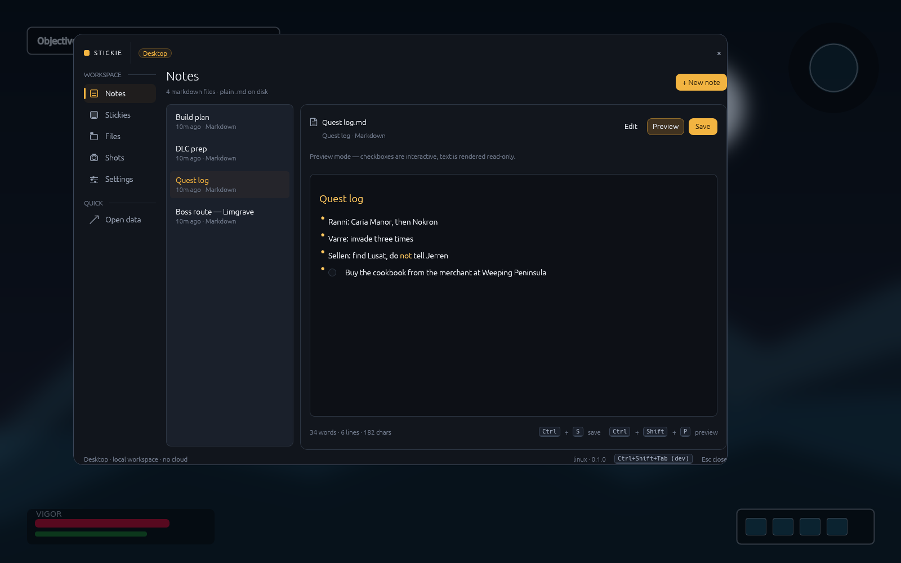
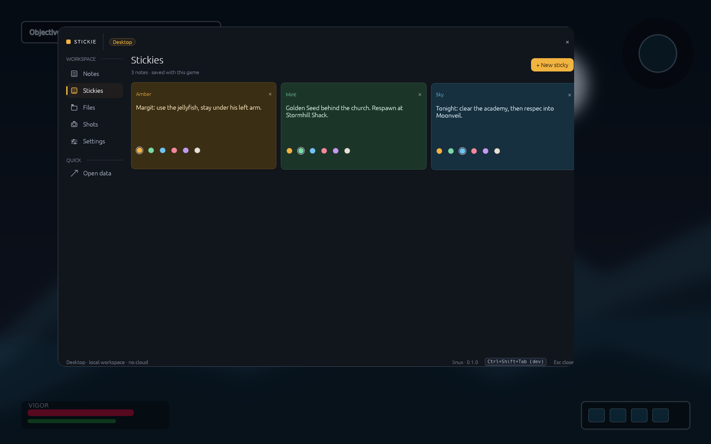
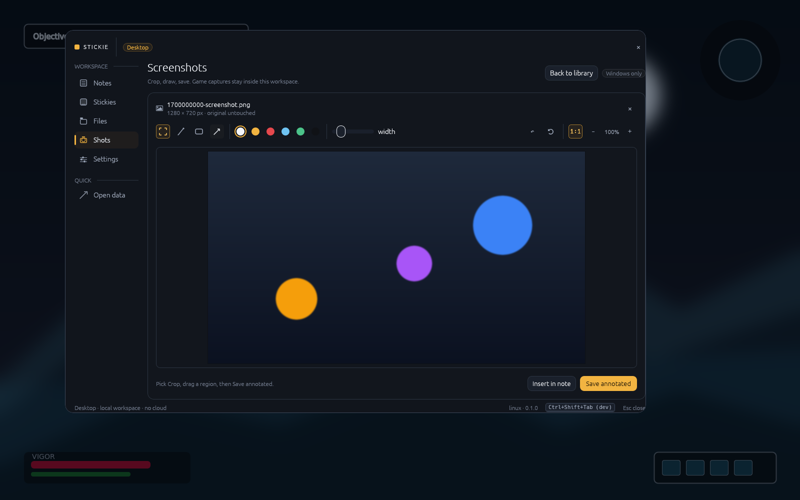
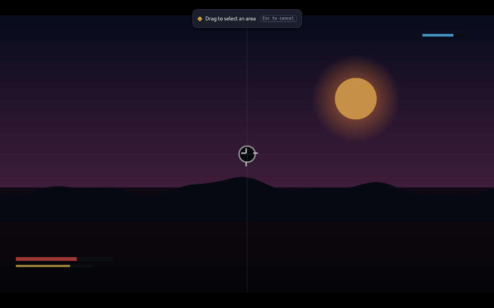
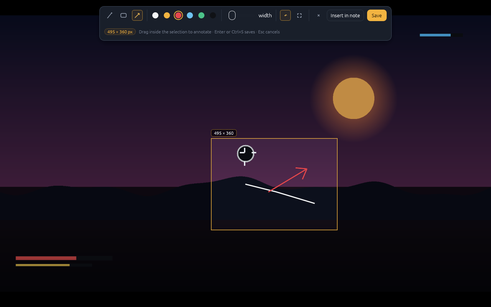
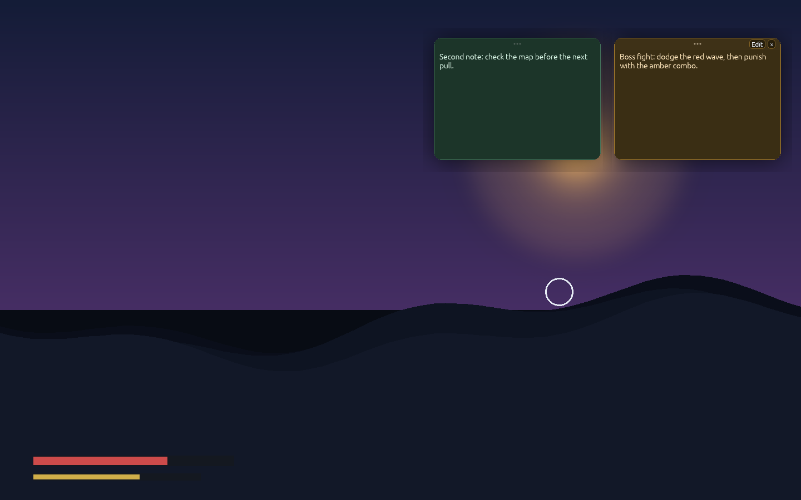

# Stickie

> Notes at the speed of play — a lightweight, notes-first replacement for the Steam overlay.

[](https://github.com/afonsolage/stickie-app/actions/workflows/ci.yml)

Stickie is a Windows 11 overlay for taking notes while gaming. Press the hotkey,
and a quiet, transparent surface appears over your game: Markdown notepads,
sticky notes, screenshots you can crop and draw on, and a per-game folder for
everything else. Press it again and it disappears — no other process, no
background polling, no injected hooks.

Built with [Bevy](https://bevy.org) for the window/render loop and
[egui](https://github.com/emilk/egui) for the interface. Windows is the product
target; Linux builds exist so the UI can be developed without a Windows machine.

**Project status: early scaffold.** The architecture, storage layer, UI shell,
Markdown editor, sticky board, Lightshot-style capture overlay and Windows platform layer are
wired together and covered by tests. Windows 11 validation and signed releases
are the next milestone; expect rough edges and breaking changes.



*UI preview from the Linux development build, composited over a synthetic game
backdrop. The Windows build adds global-hotkey and capture affordances; see
[Design and engineering notes](#design-and-engineering-notes).*

### A quick look

| Stickies | Saved-screenshot editor |
| --- | --- |
|  |  |

| Capture: drag a region | Capture: annotate and save |
| --- | --- |
|  |  |



*Pinned screen stickies over a synthetic game backdrop. The cards stay on top
of the game while the main overlay is hidden; the Edit/Unpin controls appear on
hover. Dev-build UI preview, not actual gameplay.*

## Why another overlay?

Steam's overlay is great at chat and screenshots, but not at helping you *think*
while you play. Stickie focuses on one job: capture the things you want to
remember, without leaving the game or alt-tabbing into a browser.

- **No telemetry, no account, no network.** Your notes are files in `%APPDATA%`.
- **Game-aware.** Each executable gets its own workspace. Reopen the overlay and
  you are back in the right game's notes and folder.
- **Cheap while hidden.** The overlay window is hidden and the event loop sleeps
  until the global hotkey wakes it. No timers polling the foreground game.
- **No injection.** It is a transparent, topmost DWM window. This is friendlier
  to anti-cheat than a graphics hook, and it means exclusive-fullscreen games are
  not covered (see [Known limitations](#known-limitations)).
- **Plain files.** Notes are `.md`; screenshots are `.png`; saves and builds live
  in a normal folder tree. Delete the app and your work is still there.

## Features

| Area | What it does | Status |
| --- | --- | --- |
| Overlay shell | Transparent, always-on-top, borderless overlay with a subtle dark scrim and minimal chrome | MVP (Windows validation pending) |
| Hotkey | `Win + Shift + Tab` by default; rebindable in Settings / `config.toml`; falls back to `Ctrl + Shift + Tab` if registration fails | MVP (Windows) |
| Game workspaces | Foreground executable detected when the overlay opens; one workspace per game | MVP (Windows) |
| Notepads | Markdown files with formatting toolbar, live preview, keyboard shortcuts and debounced autosave | MVP |
| Sticky notes | Color-coded quick notes persisted per game | MVP |
| Screen stickies | Pin any sticky to a small always-on-top window over the game; minimal card with hover-only Edit/Unpin controls and persisted screen position | MVP (Windows) |
| Capture overlay | Freeze the primary display, drag-select a region, then pen/rectangle/arrow annotate and save or insert into the note | MVP (Windows) |
| Screenshot editor | Open saved captures to re-crop, draw (pen/rectangle/arrow), undo or save an annotated copy; high-resolution preview textures are downscaled to the GPU budget | MVP |
| Folders | Organize saves/files under each workspace; remembers the last opened folder | MVP |
| Capture backend | Windows Graphics Capture of the primary display through a worker thread | MVP (Windows) |
| Settings | Hotkey, overlay dim, launch behavior, data folder | MVP |
| Multi-monitor positioning | Overlay opens on the game’s monitor | Planned |
| Exclusive-fullscreen overlay | D3D/Vulkan swapchain hooking | Out of scope for now |
| Steam app-id mapping | `steam:<appid>` workspace ids and library metadata | Planned |

## Quick start (Windows 11)

Requirements:

- Windows 11
- [Rust](https://rustup.rs) stable (the project MSRV is 1.97)
- Visual Studio Build Tools with the “Desktop development with C++” workload
  (for the Rust MSVC linker)

```powershell
git clone https://github.com/afonsolage/stickie-app
cd stickie-app
cargo build --release
.\target\release\stickie.exe
```

The app starts hidden. Press `Win + Shift + Tab` while a game (or anything else)
is focused. Press the same chord or `Esc` to hide it.

If the configured hotkey cannot be registered (another app may own it), Stickie
falls back to `Ctrl + Shift + Tab` and shows the overlay so the binding can be
fixed in **Settings**.

### Linux development build

Linux has UI, storage and Markdown support but no global-hotkey or capture
backend yet:

```bash
cargo run
# or force the overlay visible:
STICKIE_SHOW_ON_START=1 cargo run
```

The dev shortcut to toggle is `Ctrl + Shift + Tab`; see
[docs/architecture.md](docs/architecture.md) for the platform boundary.

### Running the Windows client from WSL

Stickie can be cross-compiled and launched natively on Windows from WSL, which
makes manual overlay testing much faster than copying binaries around:

```bash
# one-time setup
cargo install just
cargo install cargo-xwin
rustup target add x86_64-pc-windows-msvc

# build and launch
just c
```

`just c` (alias for `just client-win`) detects an installed Rust toolchain with
the Windows MSVC target, cross-compiles through `cargo-xwin`, and launches
`target/x86_64-pc-windows-msvc/debug/stickie.exe` through WSL interop. Dev runs
start visible by default; use `STICKIE_SHOW_ON_START=0 just c` to test the hidden
startup/hotkey flow, or `STICKIE_WIN_PROFILE=release just c` for an optimised
build. Windows logs are forwarded to the WSL terminal via `WSLENV`. The app
selects the DX12 DirectComposition path internally for transparency; do not
override `WGPU_BACKEND` unless you are debugging the renderer.

If the automatic toolchain detection does not find one, point it explicitly:

```bash
STICKIE_WIN_TOOLCHAIN=nightly-2026-08-15 just c
```

The app still stores data under `%APPDATA%\Stickie\data` on the Windows side;
use `STICKIE_DATA_DIR` with a Windows path if you want a disposable test
workspace.

## Where your data lives

```text
%APPDATA%\Stickie\data\
├── config.toml
├── logs\
└── workspaces\
    └── exe-eldenring\
        ├── workspace.toml      # display name, stickies, screen pins, last folder
        ├── Notes\              # plain Markdown files
        ├── Screenshots\        # PNG captures and annotations
        └── Files\              # your folders: saves, builds, reference images
```

Set `STICKIE_DATA_DIR` to use a different root (handy for testing or a portable
install on another drive).

Workspaces are keyed by executable, e.g. `exe:eldenring`. The display name comes
from the foreground window title. No game launcher integration is required.

## Keyboard

| Shortcut | Action |
| --- | --- |
| `Win + Shift + Tab` | Toggle the overlay (configurable) |
| `Esc` | Close the overlay |
| `Ctrl + 1…5` | Jump to Notes / Stickies / Files / Shots / Settings |
| `Ctrl + S` | Save the open note or annotated screenshot (notes also autosave) |
| `Ctrl + B` / `Ctrl + I` | Bold / italic selection in the Markdown editor |
| `Ctrl + Shift + P` | Toggle the Markdown preview |

## Design and engineering notes

- [Architecture](docs/architecture.md) — module map, state machine, storage
  layout, performance targets and the “do nothing while hidden” rule.
- [UX benchmark and UI specification](docs/ux-benchmark.md) — competitive
  research across Steam Overlay, Discord, Xbox Game Bar, Overwolf, Medal,
  Windows Sticky Notes, Obsidian, Notion and screenshot tools, plus the design
  tokens and wireframes used by Stickie. The final implementation notes (warm
  amber accent instead of the spec's blue, 45% default scrim, 128 px labelled
  rail) are documented at the end of that file.

The UI is built on egui and rendered through `bevy_egui`; Bevy itself is kept on
a minimal feature set (window, wgpu renderer, asset/log only). The separate
`examples/component_gallery.rs` renders the design system and both editors
without the full overlay, which is useful for visual review.

## Building and testing

```bash
cargo fmt --all -- --check
cargo clippy --all-targets -- -D warnings
cargo test --all-targets
```

The `component_gallery` example renders the design-system widgets and both
editors without needing the full overlay:

```bash
cargo run --example component_gallery
cargo run --example component_gallery -- path/to/capture.png
```

CI runs formatting, clippy, the full test suite and a release build on the
Windows target. See [CONTRIBUTING.md](CONTRIBUTING.md) if you want to help.

## Known limitations

- **Exclusive fullscreen is not covered.** The overlay is a borderless window
  covering the primary monitor, composited by DWM over windowed/borderless-windowed
  games. True exclusive-fullscreen support needs swapchain injection, which this
  project intentionally avoids for now. Set affected games to borderless-windowed
  mode.
- **Windows transparency uses DX12 DirectComposition.** Stickie defaults
  `WGPU_BACKEND=dx12` and `WGPU_DX12_PRESENTATION_SYSTEM=visual` so the alpha
  channel reaches DWM. Overriding `WGPU_BACKEND` (for example to Vulkan) can
  make the overlay background opaque/black; run without that override for the
  normal transparent overlay.
- **Windows only for the real overlay.** Linux builds are for UI development;
  there is no X11/Wayland global hotkey or capture backend.
- **Not an injected overlay.** Some games with aggressive anti-cheat may still
  dislike *any* topmost window. Stickie never reads or writes game memory and
  never injects a DLL.
- **The overlay follows the primary monitor at startup.** Multi-monitor games
  will get proper positioning in a follow-up.
- **Screenshot capture is Windows-only in practice.** The editor and storage are
  cross-platform; on Linux the capture button is hidden. Some games block
  Windows Graphics Capture (protected content); the app falls back to a display
  capture.
- **Elevated/protected games can hide their identity.** If Windows refuses the
  foreground-process query, Stickie falls back to the `Desktop` workspace rather
  than guessing. Running both at the same integrity level fixes it.
- **Windows 11 validation is pending.** The Windows-specific code is type-checked
  in CI and was cross-checked against the `x86_64-pc-windows-msvc` target, but
  this scaffold has not yet been exercised on a physical Windows 11 game setup.
- Early software: expect API, storage-format and UI changes. Back up notes you
  care about; everything is plain files, so this is easy.

## Roadmap

- [x] Repository, architecture and UX benchmark
- [x] Minimal Bevy shell + transparent Windows overlay scaffolding
- [x] Config, per-game workspaces, Markdown notes, stickies, folders
- [x] Lightshot-style full-screen capture overlay (select, pen/rectangle/arrow, save, insert note)
- [x] Screenshot editor for saved captures and capture worker
- [x] Pinned screen stickies that remain over the game, independent of the overlay
- [ ] Windows 11 manual validation and signed release builds
- [ ] Multi-monitor overlay placement and per-game display memory
- [ ] Rebindable hotkey capture UI and conflict diagnostics
- [ ] Steam app-id mapping, recent-game switcher and workspace renaming
- [ ] Clipboard copy, text/highlighter tools and multi-monitor capture
- [ ] Auto-update or portable build (opt-in, no telemetry)

## License

[MIT](LICENSE) © 2026 Afonso Lage

Bevy and egui are used under their respective MIT/Apache-2.0 licenses.
