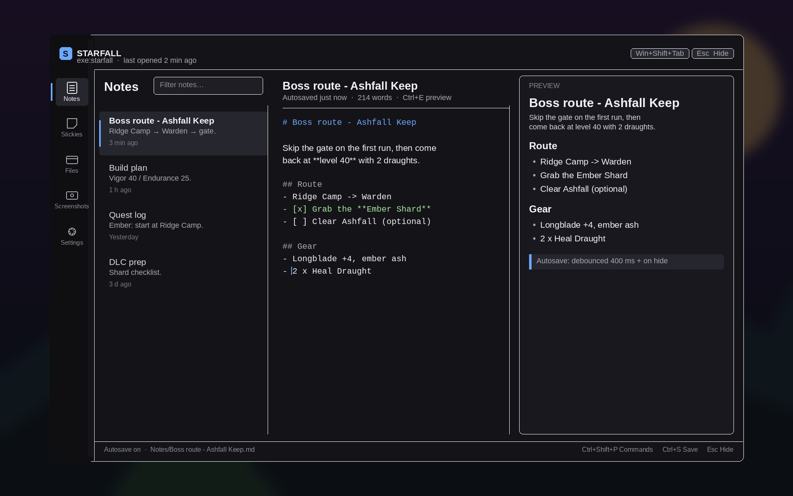

# Stickie UX/UI benchmark and MVP specification

**Status:** draft for MVP · **Last updated:** 2026-11-11 · **Related:** [architecture](architecture.md)

Stickie is a Windows-first Bevy overlay for markdown notes, sticky notes, screenshot markup and per-game workspaces. This brief benchmarks comparable products and fixes the UI decisions for the MVP. Bracketed numbers map to [Sources](#sources).

## 0. Method and assumptions

Vendor docs are the evidence base; unverifiable appearance is marked *assumption*. Layout is logical pixels (egui applies DPI), games are windowed or borderless ([architecture](architecture.md)), there is no network or account, vendor latency numbers are claims, and the §5 wireframe is self-made.

## 1. Executive summary

Four camps: social overlays [1][2][3]; capture/OS overlays [5][6][8][9]; note apps [10][12][13][15]; capture/canvas tools [16]–[20]. None pairs a game-aware workspace with markdown notes. Stickie's niche: **notes that open in under a second, without touching the game process**.

Patterns to adopt:

1. **One toggle, one exit.** Shift+Tab [1], Shift+\` [3], Alt+Z [4], Win+G [7], Ctrl+Tab [8] — one shortcut, no data loss.
2. **User-tuned visual weight.** Pin opacity [2], overlay transparency [3][4], widget opacity 0–100 [6]: ship two sliders, not a theme editor.
3. **Per-game context.** Notes and layout per game [2], per-game settings [8], per-game enabling [3]: derive the workspace from the foreground exe.
4. **Silent autosave plus an explicit save.** Sticky Notes and OneNote autosave [10][12]; still bind Ctrl+S and show "Saved · just now".
5. **Keyboard-first with a command palette.** Obsidian's fuzzy Ctrl+P [14] is the cheapest power path; everything keeps a mouse affordance.
6. **Capture, annotate, saved — one flow.** Snipping Tool and ShareX never separate capture from markup [16][17].
7. **Stickies are glanceable, not a whiteboard.** Sticky Notes' flat list beats Excalidraw's canvas [10][20] in a two-second window.

## 2. Competitive matrix

Chrome = attention cost while open. "—" = not offered.

| Product | Activation | Chrome / attention | Background | Navigation | Notes / stickies | Screenshot + annotation | Per-game | Files / folders | Strengths / failure modes |
|---|---|---|---|---|---|---|---|---|---|
| **Steam Overlay** [1][2] | Shift+Tab [1] | Full-screen window toolbar | Near-opaque dark layer | Overlay windows saved per game [2] | Per-game rich-text Notes, images [2] | Library, no draw [2] | Yes [2] | Internal only | Pin-to-game and memory; failure: injection, heavy [1] |
| **Discord Overlay** [3] | Shift+\` [3] | Small voice/chat widgets | Transparent | Show/hide widgets | — | — | Per-game enable [3] | — | Glanceable voice; failure: config sprawl, lag [3] |
| **Xbox Game Bar** [5][6][7] | Win+G [7] | Widgets plus home bar | Translucent, opacity 0–100 [6] | Widget host: pin, favourite [6] | — | OS capture shortcuts [7] | — | — | OS pinning/click-through; failure: background overhead [30] |
| **NVIDIA app** [4] | Alt+Z [4] | HUD panes | Opacity setting [4] | Shortcut panels | — | Alt+F1 capture, no draw [4] | — | — | Clean capture; failure: no notes |
| **Overwolf** [8] | Ctrl+Tab dock [8] | App dock plus windows | App-dependent | Dock + Appstore | App-dependent | App-dependent | Overlay, hotkeys, auto-launch [8] | App-dependent | Per-game model; failure: heavy platform |
| **Medal** [9] | Auto-overlay on game [9] | Small capture overlay | No dim | Capture options | — | Screenshots and clips; F8 [9] | Detects game | Capture library | Zero-config; failure: capture-only |
| **Sticky Notes** [10][11] | Ctrl+N or + [10] | Desktop notes plus list | Solid colours | Flat newest-first list [10] | Rich text, colours, images; no topmost [10] | Source-linked screenshots [11] | — | — | Frictionless; failure: no folders or markdown [10] |
| **OneNote Quick Notes** [12] | Win+Alt+N [12] | Small note windows | Solid | Notebook hierarchy | Rich text, inking, pin [12] | Formatting toolbar [12] | — | Notebooks/sections | Structure and pinning; failure: heavy account context |
| **Obsidian** [13][14] | App launch | Full desktop app | Opaque | Sidebar, Ctrl+P palette [14] | Local markdown, links, graph [13] | — | Vaults | Vault folders, open formats [13] | Local markdown + palette; failure: no overlay |
| **Notion** [15] | App/web launch | Full desktop app | Opaque | Sidebar, unlimited nesting [15] | Rich pages | — | — | Pages/databases | Strong IA; failure: account/network-first |
| **Snipping Tool** [16] | Win+Shift+S [7][16] | Toolbar then editor | Screen turns gray [16] | Capture modes [16] | — | Pen, shapes, crop, OCR, auto-save [16] | — | Screenshots folder [16] | One-shortcut capture; failure: no library |
| **ShareX** [17] | Hotkeys and tray | Region toolbar | Region overlay | Tray and workflows | — | Deep toolbox, after-capture tasks [17] | — | Templates, folders, uploads [17] | Automation; failure: config burden |
| **Greenshot / Shottr** [18][19] | Hotkeys and tray | Minimal toolbars | Region / frozen screen | Toolbar editors | — | Annotate, obfuscate, OCR, pin [18][19] | — | Save folders [18][19] | Lightweight, fast (vendor claim 17 ms [19]); failure: no game context |
| **Excalidraw** [20] | Web/app launch | Full canvas | Opaque | Infinite canvas | Canvas drawings [20] | Export PNG/SVG/clipboard [20] | — | `.excalidraw` files [20] | Sketches well; failure: canvas-first |

## 3. Lessons by surface

### 3.1 Overlay shell and scrim

Windows' "Smoke" is the always-translucent-black material that dims content beneath a blocking modal; Acrylic blur is reserved for transient flyouts [22]. Steam can let a game pause itself via `GameOverlayActivated_t` [1]; Stickie has no such hook and assumes the game keeps rendering. **Decision:** full-monitor transparent topmost window; scrim `#000000` 55% (range 0–80%); panel `#141418` 92% (range 70–100%); no blur; separate *Dim game* and *Panel opacity* sliders; the panel is the only interactive surface.

### 3.2 Navigation and information architecture

Steam's windowed toolbar [2] and Notion's nesting [15] suit desktop apps, not a two-second overlay; Obsidian's fuzzy Ctrl+P palette is the best power path [14]. **Decision:** five destinations in a 72 px rail — Notes, Stickies, Files, Screenshots, Settings; one tree level, in Files; a workspace chip opens the recent-five list and "Open folder in Explorer"; Ctrl+1..5 switch, Ctrl+Shift+P opens the palette, Esc unwinds popup → editor → list → hide; no tabs, nested settings or cross-workspace search.

### 3.3 Notepad editing and preview

Steam Notes proves per-game demand: rich text, pasted images, offline use [2]; Obsidian proves local markdown [13]; Notion's block editor is out of proportion here [15]. **Decision:** one note = one `Notes/*.md`; list by modified; title from the first H1 or filename; monospace source plus Ctrl+E preview (`egui_commonmark`), no WYSIWYG; formatting shortcuts insert syntax; autosave debounced 400 ms and flushed on hide; Ctrl+S gives a "Saved · just now" status; failures keep content with [Retry] [Open folder]; preview text caps at 60 characters per line [23], source wraps near 90; scroll sync, tables and images are post-MVP.

### 3.4 Sticky notes: creation and spatial layout

Sticky Notes sets the friction bar — Ctrl+N, autosave, colours, images — and documents its limits: no always-on-top, no reorder, newest-first list, no folders [10]. Its 2024 app adds source-linked screenshots [11]; OneNote Quick Note adds Win+Alt+N and pinning [12]; Excalidraw shows the canvas alternative [20]. **Decision:** responsive 2–4 column board, 240×180 minimum cards, six paper colours, inline edit, Ctrl+Shift+N to create, delete with 5 s undo; plain text; no freeform drag or z-order in the MVP because positions need persistence, collision handling and zoom, and a 1120 px panel fits about three cards per row; no always-on-top desktop stickies.

### 3.5 Screenshot capture, crop and draw

Snipping Tool sets the flow standard: Win+Shift+S, gray screen, editor with pen/highlighter/shapes/crop, auto-save to the Screenshots folder [16]. ShareX adds after-capture tasks and the deepest toolbox [17]; Shottr claims 17 ms to grab and ~165 ms to display [19]. **Decision:** Ctrl+Shift+1 hides the overlay one frame, captures the foreground window with `xcap`, writes the raw PNG first, then reopens in a crop-and-draw editor; annotations apply to a copy, Ctrl+S overwrites atomically; Esc keeps the raw capture; ≤250 ms to editor paint; tools: crop (8 handles, Shift aspect), pen, highlighter, arrow, rectangle, text, four swatches plus hex, undo/redo 20 steps, 100% zoom; Ctrl+C copies; no OCR, blur, scrolling capture, video or GIF.

### 3.6 Workspace and game-context switching

Steam saves notes and layout per game [2], Overwolf exposes per-game overlay/hotkeys [8], Discord enables per game [3], and the architecture defines per-workspace folders. **Decision:** probe the foreground once per open; id = `"exe:" + normalized stem`; display name from the window title; a failed probe falls back to a `Desktop` workspace with a muted "No game detected" chip; restore last destination, last Files folder and last selection; switching workspaces is a full reload with a 120 ms cross-fade; no cross-workspace search; "Open in Explorer" sits in the workspace chip.

### 3.7 Settings and hotkey discoverability

Documented defaults make shortcuts learnable [1][3][4][7], Discord and Overwolf rebind with a recorder [3][8], and Game Bar widgets can expose a settings button [6]. **Decision:** Settings holds hotkey, *Dim game*, *Panel opacity*, data path with reveal, reduce motion, UI scale (100/125/150%), reset onboarding and version. The hotkey row shows the binding, a "Change" recorder validating `RegisterHotKey` ("In use by another app" on failure) and presets; warn on Shift+Tab [1], Shift+\` [3], Alt+Z/Alt+R [4], Win+G [7], Win+Shift+S [7][16]. The data path is never hidden.

### 3.8 Performance perception

NN/g's limits hold: 0.1 s feels instant, 1 s keeps flow, 10 s is the attention limit [26]; Windows pairs 150 ms exits with 300 ms entrances [25]. Hidden cost outweighs open cost. **Decision:** hidden means no frames, polling or timers beyond the hotkey window; ≤100 ms to a painted cached shell; refresh after first paint; no spinner under 300 ms; skeleton rows only past 150 ms; animations 100–150 ms; thumbnails decoded lazily; saves debounced 400 ms; capture ≤250 ms. Measure all of it in CI.

## 4. MVP UI specification

### 4.1 Window, content and spacing

| Token | Value | Notes |
|---|---|---|
| Overlay window | full monitor, borderless, topmost, transparent | on the game's monitor |
| Panel | 1120×680 logical at 1080p | min 960×600, max 1280×760; centred; 8 px radius [21] |
| Header / rail / status | 56 / 72 / 32 px | rail items 44 px: 16 px icon + 10 px caption |
| Padding / gaps | 24 px outer, 16 px regions, 12 px groups, 8 px controls [24] | list pane 264 px, collapses below 1100 px |
| Controls | 32 px tall, 4 px radius [21] | 32×32 target; WCAG floor 24×24 [28] |
| egui overrides | `interact_size=(32,28)`, `animation_time=0.12`, tooltip 0.35 s | egui 0.36.2 defaults (40×18, 0.2 s) are too small/slow |

### 4.2 Colour tokens

sRGB; alpha applies over game content; ratios are against `shell`.

| Token | Value | Use | Contrast |
|---|---|---|---|
| `scrim` | `#000000` @ 55% | dim game behind panel | — |
| `shell` | `#141418` @ 92% | panel background | — |
| `rail` | `#0F0F12` @ 85% | destination rail | — |
| `surface` / `-hover` / `-active` | `#1E1E24` / `#26262E` / `#2E2E38` | cards, rows, selection | — |
| `border` | `#FFFFFF` @ 8% | 1 px separators and edge | — |
| `text` / `text-muted` | `#F2F2F5` / `#A8A8B3` | body / metadata | 16.4:1 / 7.8:1 |
| `accent` | `#6EA8FE` | selection bar, focus ring, primary | 7.6:1; `#0B0B0F` on accent 8.1:1 |
| `danger` / `success` / `warning` | `#FF6B6B` / `#5BD6A2` / `#FFC857` | errors / saved / warnings | 6.6 / 10.1 / 11.9:1 |
| `sticky-*` | `#FFD866`, `#A8E6A1`, `#9AD5FF`, `#FFB3C1`, `#CBA8FF`, `#E6E6E6` | sticky fills | `#17171B` text ≥9:1 |

Never encode state by colour alone; pair it with an icon or text. Body text ≥4.5:1, large text ≥3:1 [27].

### 4.3 Typography

Bundle **Inter** (SIL OFL) for UI and **JetBrains Mono** (SIL OFL) for the editor; prefer Segoe UI Variable when present but never redistribute it. egui's default Ubuntu-Light is development-only.

| Style | Size / line / weight | Use |
|---|---|---|
| Display | 20 / 28 / semibold | destination title, panel header |
| Heading | 16 / 24 / semibold | sections, sticky title |
| Body / Body strong | 14 / 20 / regular or semibold | lists and buttons / selected rows |
| Caption | 12 / 16 / regular | metadata, hotkey hints |
| Mono | 13 / 20 / regular | markdown source, paths |

Minimum 12 px regular and 14 px semibold [23]; sentence case everywhere [23]; preview text 50–60 characters per line [23]; UI scale multiplies the ramp rather than re-tuning it.

### 4.4 The five destinations

| Destination | Purpose | Empty state | Primary action | Keyboard |
|---|---|---|---|---|
| **Notes** | markdown notepads per game | "No notes yet. Your first note is one shortcut away." | New note | Ctrl+N, Ctrl+E |
| **Stickies** | glanceable cards per game | "Stick a thought to this game." | New sticky | Ctrl+Shift+N |
| **Files** | user folders (saves, builds, configs) | "Point Stickie at a folder." | Open last folder | Ctrl+O, Backspace up |
| **Screenshots** | capture library and crop/draw editor | "Nothing captured yet. Ctrl+Shift+1 grabs the game." | Capture, then editor | Ctrl+Shift+1, Ctrl+C, Ctrl+S |
| **Settings** | hotkey, opacity, data, motion, scale | — | Rebind hotkey | Ctrl+, |

Primary actions top-right; destructive actions are row icons; empty states name the filling shortcut.

### 4.5 First run and normal open

**First run:** opens on Notes with a dismissible three-line card — "Open anytime with Win+Shift+Tab — [Change]", "Notes are saved per game in `%APPDATA%\Stickie` — [Open folder]", "Try a screenshot: Ctrl+Shift+1". No wizard or account; the card returns only from Settings → Reset onboarding.

**Normal open:** request focus → probe foreground once → resolve workspace → paint cached shell → restore last destination and selection → refresh data. A failed probe shows the `Desktop` workspace; a new workspace lands on the Notes empty state; an exclusive-fullscreen game gets one inline banner ("Switch the game to borderless"), never a dialog. **Close:** flush saves, hide, restore game focus; never prompt "save?".

### 4.6 Keyboard and focus model

| Key | Action |
|---|---|
| Win+Shift+Tab | toggle overlay (global, configurable) |
| Esc | close popover → leave editor → hide, in that order |
| Ctrl+S / Ctrl+Shift+P | save now / command palette (fuzzy, recent first) |
| Ctrl+1..5 / Ctrl+N / Ctrl+Shift+N / Ctrl+Shift+1 | destinations / new note / new sticky / capture |
| Ctrl+C, Ctrl+V | copy image, paste image into a sticky |
| Ctrl+E / F2 / Delete | toggle preview / rename / delete with 5 s undo |
| Tab, Shift+Tab, arrows, Enter, Space | focus traversal, list navigation, activate, preview |

The overlay grabs focus on show on the destination's primary list, never a text field, so the first keystroke navigates. Focus ring: 2 px `accent`, 2 px offset. Esc in a text field only closes inline autocomplete. Every action is mouse-reachable.

### 4.7 Errors, toasts and recovery

- Inline dismissible banner for persistent failures, e.g. "Couldn't save note (access denied). Your changes are still in memory." with [Retry] [Open folder] [Copy error].
- Toasts bottom-right, max three: 3 s success, 6 s error, 5 s undo; deletes use undo, not a modal.
- No dialogs for routine errors (modals only for workspace deletion, post-MVP); the panel never blanks; last good content stays with the banner.
- Copy pattern: what failed, data safety, next action; never a raw `anyhow` chain without a detail view.

### 4.8 Motion

| Element | Timing | Easing |
|---|---|---|
| Overlay open / close | 150 ms fade + 8 px rise from 98% / 100 ms fade | decelerate / accelerate |
| Destination switch / palette | 120 ms / 100 ms cross-fade | standard / decelerate |
| Sticky create | 120 ms scale 0.96→1 | standard |
| Toast | 150 ms in / 100 ms out | decelerate / accelerate |

Follows Windows conventions (150 ms exit, 300 ms entrance) [25], compressed for an overlay. Switch instantly when Windows "Animation effects" is off.

### 4.9 Accessibility

- Contrast ≥4.5:1 body and ≥3:1 large text, focus states included [27]; focus ring never removed.
- Targets ≥32×32 px (WCAG floor 24×24) [28]; crop handles get arrow-key nudges, Shift for 10 px steps.
- Full keyboard operation; nothing requires hover or drag.
- Reduce motion follows the OS setting and a Settings toggle [29]; UI scale 100/125/150%; layout reflows at 1100 px.
- Status never relies on colour alone. Screen-reader support depends on AccessKit; `bevy_egui` wiring must be verified before claiming it, so the MVP documents the gap.

## 5. Wireframe



```text
+============================= monitor 1920x1080 ==============================+
|  scrim #000000 @ 55% -- game visible but dimmed; panel is the only UI        |
|  +----------------------- command surface 1120x680 -----------------------+  |
|  |  [S] STARFALL - exe:starfall          Win+Shift+Tab    Esc Hide        |  |
|  | Notes                 [Filter notes...]                    [+ New note]|  |
|  +---------+----------------+---------------------------+-----------------+  |
|  |  Notes  | Boss route     | # Boss route - Ashfall    | PREVIEW         |  |
|  |  Sticky | Build plan     | Skip the gate on first run| Boss route      |  |
|  |  Files  | Quest log      | then return at level 40   | Route           |  |
|  |  Shots  | DLC prep       | with 2 draughts.          | - Ridge Camp    |  |
|  |  Sett.  |                | ## Route                  | - Grab Ember    |  |
|  |         |                | - Ridge Camp -> Warden    | - Clear Ashfall |  |
|  |         |                | - [x] Grab Ember Shard    | ## Gear         |  |
|  |         |                | - [ ] Clear Ashfall       | - Longblade +4  |  |
|  |         |                | ## Gear                   | - 2 x Draught   |  |
|  |         |                | - Longblade +4            |                 |  |
|  |         |                | - 2 x Heal Draught        |                 |  |
|  +---------+----------------+---------------------------+-----------------+  |
|  | Autosave on - Notes/Boss route - Ashfall Keep.md  Ctrl+Shift+P  Esc    |  |
|  +------------------------------------------------------------------------+  |
|   ctrl+1..5 destinations | ctrl+shift+n new sticky | esc hides overlay       |
+==============================================================================+
```

## 6. Anti-patterns and out of scope

**Do not do**

- Inject into game processes, claim exclusive-fullscreen support, or auto-capture/upload/sync while hidden.
- Ship a blur/acrylic shader for a full-screen panel [22].
- Modal-confirm every action, spinner sub-300 ms work, or blank the panel while refreshing.
- WYSIWYG, plugin system, theme editor; colour-only state; text below 12 px [23]; hidden hotkey or data path.
- Rebuild Steam features: chat, voice, achievements, store, browser, library management.

**Out of scope for the MVP**

- Freeform sticky canvas, drag/z-order, always-on-top desktop stickies.
- OCR, blur/pixelate, scrolling capture, video/GIF, clipboard history, cloud sync, accounts, share links, telemetry, auto-update.
- Rich-text notes, rendered images in notes, backlinks, graph, tags, full-text search.
- Multiple overlay windows, pinned-over-game windows, auto-launch rules, widget plugins.
- macOS/Linux UI polish beyond the stub dev target.


## 7. Implementation reconciliation (current build)

The design system in `src/ui/theme.rs` was implemented from this brief and makes
a few deliberate deviations to reduce visual weight and keep the first build
small. They are recorded here so the spec and the app do not drift apart:

| Spec decision | Shipped in the MVP | Why |
|---|---|---|
| Blue accent `#6EA8FE` | Warm amber `#F2B441` (accent), on-accent `#1A1409` | Amber separates Stickie's chrome from the blue/cyan HUD conventions common in games and stays legible on dark gameplay (contrast checked in `theme.rs` tests). |
| Shell `#141418` @ 92%, rail `#0F0F12` | Opacity-rich dark surfaces: shell `#12161D` (246/255), raised `#1A202B`, input `#0D1016` | Fewer translucent layers on wgpu/compositor paths; the game still shows through the scrim and panel edges. |
| 55% scrim | 45% default, user range 0–85% | The request was for a very light darkening; 45% leaves gameplay readable while the panel stays opaque. |
| 1120×680 panel, 72 px rail | Up to 1180×780 (responsive), 128 px labelled rail | The labelled rail is clearer than an icon-only rail at 1440p and uses the width freed by the compact panel. |
| Command palette, restore last destination | Not in the first build | Roadmap: Ctrl+1–5 tab switching and per-workspace last folder ship now; palette/selection restore is next. |
| `Ctrl+Shift+1` capture, text/highlighter tools | Capture button in the top bar / Quick rail; crop, pen, rectangle, arrow tools | Capture is exposed where the mouse already is; the four highest-value annotation tools are implemented, with more tools planned. |
| 400 ms autosave | 900 ms idle autosave, plus flush on hide/quit and Ctrl+S | Keeps disk writes quiet during bursts of typing; no content is lost on hide/quit. |

Everything else in §4 (five destinations, scrim-only shell, Markdown
source/preview model, 2–4 column sticky board, 6 colours, file-browser last
folder, capture → crop/annotate → save/insert flow, Windows-only capture, no
telemetry) is implemented as specified.

## 8. Sources

1. [Steamworks — Steam Overlay](https://partner.steamgames.com/doc/features/overlay)
2. [Steam — Steam Desktop Update, 2023-06-15](https://store.steampowered.com/news/app/593110/view/3687931965598906184)
3. [Discord — Game Overlay 101](https://support.discord.com/hc/en-us/articles/217659737-Game-Overlay-101)
4. [NVIDIA — In-Game Performance and Latency Overlay](https://nvidia.custhelp.com/app/answers/detail/a_id/5084)
5. [Microsoft Learn — Game Bar overview](https://learn.microsoft.com/en-us/xbox/game-bar/overview)
6. [Microsoft Learn — XboxGameBarWidget API](https://learn.microsoft.com/en-us/xbox/game-bar/api/xgb-widget)
7. [Microsoft Support — Windows keyboard shortcuts](https://support.microsoft.com/en-us/windows/keyboard-shortcuts-in-windows-dcc61a57-8ff0-cffe-9796-cb9706c75eec)
8. [Overwolf Support — Game Settings](https://support.overwolf.com/support/solutions/articles/9000178795/)
9. [Medal Support — How to Capture with Medal](https://support.medal.tv/support/solutions/articles/48001157618)
10. [Microsoft Support — Create a sticky note](https://support.microsoft.com/en-us/windows/apps/stickynotes/create-a-sticky-note)
11. [MSPoweruser — new Sticky Notes app preview](https://mspoweruser.com/the-new-sticky-notes-app-on-windows-is-here-i-repeat-sticky-notes-is-here-almost/) (third-party)
12. [Microsoft Support — Create Quick Notes](https://support.microsoft.com/en-us/OneNote/onenote-help-and-learning/create-quick-notes)
13. [Obsidian — homepage](https://obsidian.md/)
14. [Obsidian Help — Command palette](https://help.obsidian.md/plugins/command-palette)
15. [Notion Help — Navigate with the sidebar](https://www.notion.com/help/navigate-with-the-sidebar)
16. [Microsoft Support — Use Snipping Tool](https://support.microsoft.com/en-us/windows/use-snipping-tool-to-capture-screenshots-00246869-1843-655f-f220-97299b865f6b)
17. [ShareX — official site](https://getsharex.com/)
18. [Greenshot — official site](https://getgreenshot.org/)
19. [Shottr — official site](https://shottr.cc/)
20. [Excalidraw — GitHub README](https://github.com/excalidraw/excalidraw)
21. [Microsoft Learn — Geometry in Windows](https://learn.microsoft.com/en-us/windows/apps/design/signature-experiences/geometry)
22. [Microsoft Learn — Materials in Windows](https://learn.microsoft.com/en-us/windows/apps/design/signature-experiences/materials)
23. [Microsoft Learn — Typography in Windows](https://learn.microsoft.com/en-us/windows/apps/design/style/typography)
24. [Microsoft Learn — Content layout and spacing](https://learn.microsoft.com/en-us/windows/apps/design/style/spacing)
25. [Microsoft Learn — Animations in Windows apps](https://learn.microsoft.com/en-us/windows/apps/develop/motion/motion-in-practice)
26. [Nielsen Norman Group — Response Times](https://www.nngroup.com/articles/response-times-3-important-limits/)
27. [W3C WAI — SC 1.4.3 Contrast (Minimum)](https://www.w3.org/WAI/WCAG21/Understanding/contrast-minimum.html)
28. [W3C WAI — SC 2.5.8 Target Size (Minimum)](https://www.w3.org/WAI/WCAG22/Understanding/target-size-minimum.html)
29. [W3C WAI — SC 2.3.3 Animation from Interactions](https://www.w3.org/WAI/WCAG21/Understanding/animation-from-interactions.html)
30. [MakeUseOf — disabling Xbox Game Bar](https://www.makeuseof.com/disabling-xbox-game-bar-better-performance/) (third-party)
